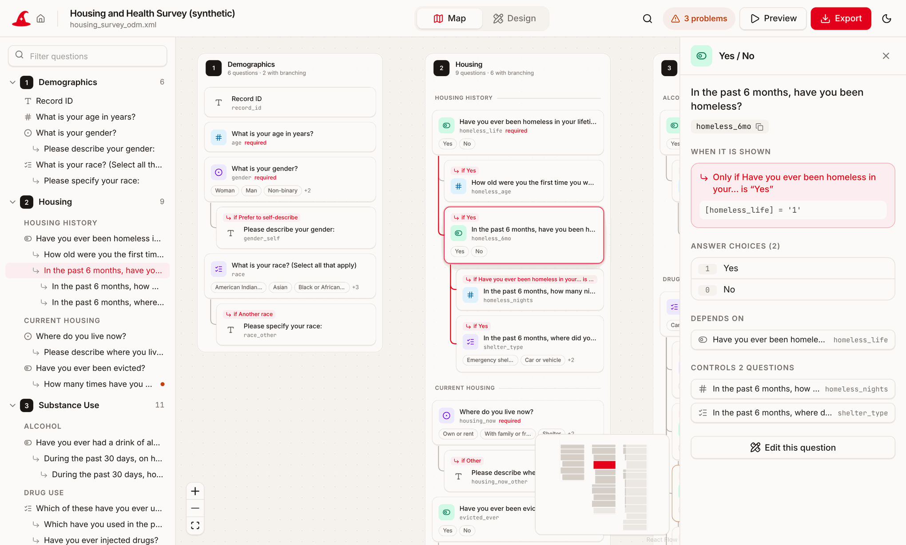
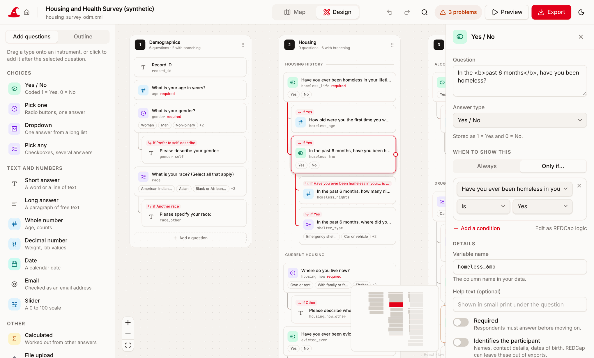

# XML Wizard for REDCap

> **Alpha software.** XML Wizard is an early test version. Expect rough edges, check its output
> before you rely on it, and keep a copy of your REDCap project before uploading anything it
> exports. Please report problems under [Issues](https://github.com/dpletta/xml-wizard/issues).

See the structure and branching (skip) logic of a REDCap survey at a glance,
catch logic mistakes before they cost you data, and hand your coding agent
(Claude Code, Codex, Cursor, …) everything it needs to clean and analyse the
data correctly.

```text
xml-wizard my_project.xml
```

produces

| Output | For | What it is |
|---|---|---|
| `survey_tree.html` | People | A zoomable, pannable tree of every instrument and item. Each item that has branching logic is nested under the item that controls it, with a tag saying when it appears ("if Yes"). Click any item for its full logic in plain English, answer codes, and problems. One file that works offline in any browser. |
| `agent_bundle/` | Coding agents | `AGENTS.md` (+ `CLAUDE.md`) primer, `codebook.json`, `skip_logic.csv`, `implied_values.csv`, and ready-to-run Python and R scripts that separate legitimate skips from real missing data. |

It also goes the other way: `xml-wizard design` opens a drag-and-drop canvas for building or editing a
survey and exporting it back to REDCap (see [Design or edit a survey](#design-or-edit-a-survey)).

## Desktop app

No Python, no terminal: download XML Wizard, open it, and drop in your REDCap file.



**Download** the installer for your computer from the [Releases page](https://github.com/dpletta/xml-wizard/releases) (the newest alpha is at the top):

| Computer | File | First launch |
|---|---|---|
| Mac (Apple silicon or Intel) | `XML.Wizard_…_universal.dmg` | Drag XML Wizard to Applications and open it once. macOS will say it cannot verify the app. Go to *System Settings → Privacy & Security*, scroll down and press **Open Anyway**. (Or run `xattr -cr "/Applications/XML Wizard.app"` in Terminal.) |
| Windows | `XML.Wizard_…_x64-setup.exe` | If "Windows protected your PC" appears, press **More info**, then **Run anyway**. |
| Linux | `.AppImage`, `.deb` or `.rpm` | For the AppImage: `chmod +x` it, then run it. |

The extra first-launch step is there because the app is not yet signed with a paid Apple or Microsoft
developer certificate. It is needed once.

What the app does:

- **Compact** shows instruments in a compact grid with accordion sections. Expand just the section
  you need; arrows connect visible questions or collapsed groups. Search opens the matching section.
  Switch between Compact, Map, and Design at the top without reopening the file or losing edits.
  Projects with more than 150 questions start in Compact; Map and Design remain one click away.
- **Map** an existing project: open a REDCap project XML or data dictionary CSV and see every instrument
  and question on a zoomable canvas. Questions with branching logic sit under the question that controls
  them, tagged with when they appear ("if Yes"). Click one for its logic in plain words, its answer codes,
  what it depends on and what depends on it. Logic mistakes are listed at the top.
- **Design** a new survey or change one: drag question types onto an instrument, drag an answer onto
  another question to branch on it, preview the survey as a respondent, and export REDCap project XML or
  a data dictionary CSV. The project XML is also your save file; unsaved work is kept on your computer.
- **Agent bundle**: *Export → Agent bundle* runs the privacy check with buttons instead of prompts
  (mask, drop or keep each flagged variable), optionally checks a data export against the logic, and
  saves the same folder the command line tool writes.



The app runs entirely on your computer and has no network code: its window is only allowed to load
files that ship inside it, so nothing can be sent anywhere. It works with the internet switched off.

To build it yourself, see [`desktop/README.md`](desktop/README.md).

## Command line

Everything runs on your computer. Nothing is uploaded. Before anything is written
for the agent, a privacy check flags variables that may identify participants
and asks whether to mask, drop or keep each one (see [Privacy](#privacy)). The
bundle holds metadata and aggregate counts, plus, only when you supply data, a
copy of that data with your chosen redactions applied.

## Install

Requires Python 3.10 or newer. There are no other dependencies.

```bash
pip install git+https://github.com/dpletta/xml-wizard
```

(`pipx install git+https://github.com/dpletta/xml-wizard` also works and keeps it isolated.)

## Use

1. In REDCap, export your project:
   - **Project XML** (recommended): *Other Functionality → Copy or back up the project → Download metadata only (XML)*,
     or *Data Exports → Other Export Options → CDISC ODM (XML)* to include data, or
   - **Data Dictionary CSV**: *Project Setup → Data Dictionary → Download the current Data Dictionary*.
2. Run:

   ```bash
   xml-wizard my_project.xml --open
   ```

   Add `--data export.csv` (a *CSV / Microsoft Excel (raw data)* export) to also check your data
   against the logic. If your XML export already includes data, this happens automatically.
3. Open `my_project_xml_wizard/survey_tree.html` (or let `--open` do it).

Other options: `--redact suggested` to accept the privacy suggestions without being asked,
`-o FOLDER` to choose where outputs go, `--check` to only print problems (exits
with code 1 when there are errors, handy in a pipeline), `--no-data-audit` to ignore data in the XML.

Try it on the included synthetic example:

```bash
xml-wizard examples/practice_data/housing_survey/housing_survey_odm.xml --open
```

A second example, the metadata of a real longitudinal REDCap project template (no record data), is in
[`examples/practice_data/most_data/`](examples/practice_data/most_data/README.md).

## Design or edit a survey

XML Wizard also works in the other direction. The designer is a drag-and-drop canvas for building a
REDCap survey, or changing one you already have, and it writes a file REDCap can upload.

```bash
xml-wizard design --open                  # start a new survey
xml-wizard design my_project.xml --open   # open an existing project to see and edit it
```

No Python? Download [`docs/designer.html`](docs/designer.html) and open it in any browser. It is one
file, works offline on a computer, tablet or phone, and uploads nothing.

- **Build:** drag a question type onto an instrument and type the question. Variable names are suggested
  from the question text.
- **Branch:** drag an answer (such as *Yes*) onto another question, and that question now shows only for
  that answer. Fine-tune it in plain words ("is at least 18", "includes Outdoors"), or edit the REDCap
  logic directly.
- **Check:** the same mistakes listed below are flagged as you work, and **Preview** lets you answer the
  survey yourself and watch questions appear and disappear.
- **Export:** *project XML* creates a new REDCap project (*New Project → Upload a REDCap project XML
  file*); *data dictionary CSV* updates an existing one (*Project Setup → Data Dictionary*).
- **Round trip:** open a REDCap project XML or data dictionary, change it, and export it again. Events,
  arms, repeating instruments and settings the designer does not show are carried through unchanged.
  Participant records in an export are never kept or written out.

The exported XML follows the layout of REDCap's own project XML export. Try the upload on a test
project first, as you would with any hand-edited data dictionary.

## What it checks

Branching logic problems REDCap does not warn you about:

| Problem | Example |
|---|---|
| Answer code that does not exist | `[evicted_ever] = '2'` on a Yes/No item (coded 1/0), so the item never shows |
| Reference to a field that does not exist | `[alc_evr] = '1'` (typo), so the item never shows |
| Checkbox referenced without an option, or with an option that does not exist | `[race] = '1'`, `[race(7)] = '1'` |
| Forward reference | An item depends on a question asked *later*, so respondents have not answered it yet |
| Self reference, references to descriptive text, unknown events, unreadable logic | |

With data supplied, it also counts, per item: answers recorded although the item should have
been hidden, blanks in items that were shown (true non-response), blanks that are skips by
design, and values that are not valid answer codes.

## Privacy

Anything a coding agent reads is sent to the company that runs its model, so names, phone numbers
and other identifiers should not reach it. Before writing the agent bundle, `xml-wizard` lists the
variables that may hold them and asks what to do with each:

```text
[6/17] loc_fname (text) "First name"  high risk: marked as an Identifier in REDCap; person's name
      M/d/k/a/? >
```

- **m**ask (the default suggestion): the column stays, but every answer becomes `[REDACTED]`. Blanks
  stay blank, so skip logic and missing-data checks still work on the redacted data.
- **d**rop: the column is removed.
- **k**eep: left as it is.
- Enter accepts the suggestion, `a` accepts all remaining suggestions, `?` shows why it was flagged.

Lower-risk variables (visit dates and short "other, please specify" answers) are asked about as a group,
and are kept unless you say otherwise.

How variables are flagged, all locally and without extra software:

| Signal | Examples |
|---|---|
| REDCap's own **Identifier** flag | any field marked *Identifier?* in the Online Designer |
| Validation type | `email`, `phone`, `zipcode`, `ssn`, `mrn_*`, dates |
| Variable name and label, matched against the HIPAA Safe Harbor identifiers | `fname`, "Last name", `dob`, "Date of birth", `address`, `cell`, "Medical record number", "Staff initials" |
| Field type | file uploads and signatures (suggested drop), long free text (`notes`) |
| The shape of the values, when data is supplied (counts only, values are never printed) | free-text answers that look like e-mail addresses, phone numbers, SSNs, or people's names |

Coded answers (radio, checkbox, dropdown, calculated) are only flagged when REDCap marks them as
identifiers. The record ID is kept so rows can be linked; make sure it is an arbitrary study ID.

What the choices change:

- `agent_bundle/data/<export>_redacted.csv` (only when you supply data, by `--data` or in the XML): your
  data with the redactions applied. Point the agent at this file. Use `--no-data-copy` to leave it out.
- `codebook.json`, `AGENTS.md` and the tree viewer say which items are masked or dropped and why, and
  `AGENTS.md` tells the agent never to try to recover them or open the original export.
- `cleaning/apply_skip_logic.py` and `.R` apply the same redactions to every file they write, even when
  run on the original export.
- Your answers are saved in `redaction_decisions.csv` in the output folder (outside the bundle). A rerun
  only asks about variables that are new; edit the file to change a decision.

Non-interactive use: `--redact suggested` accepts every suggestion, `--redact none` redacts nothing, and
`--mask a,b`, `--drop c` and `--keep d` decide individual variables. When not run in a terminal (for
example from a script), the suggestions are applied automatically.

This is a safety net, not a de-identification guarantee: free text can still mention people, and dates
and rare combinations of answers can identify someone. Give the agent the `agent_bundle` folder only,
keep the original export elsewhere, and follow your IRB's data-handling rules.

## The agent bundle

Point your agent at the folder (or copy it into your analysis project) and ask, for example:

> Read `agent_bundle/AGENTS.md`. Run the skip-logic script on `data/export.csv`, summarise the
> problems by item, and propose implied-value rules for the housing section without applying them.

Contents:

- **`AGENTS.md`**: a project-specific primer: ground rules (never edit raw data, blanks after a skip are
  not missing, confirm before imputing, keep data local), a survey map with every skip pattern written
  out, problems found, data-check summary, suggested logical fills, and analysis starting points.
  `CLAUDE.md` simply imports it, so Claude Code, Codex and Cursor all pick it up.
- **`codebook.json`**: every item with labels, answer codes, export columns, validation, and its branching
  logic as raw text, plain English, a parsed syntax tree, and equivalent Python and R expressions.
  See [docs/codebook-format.md](docs/codebook-format.md).
- **`cleaning/apply_skip_logic.py`** and **`.R`**: no-dependency scripts that read your raw export and write a
  cleaned copy with a `<field>__skip` status column (`shown_answered`, `shown_missing`, `skipped`,
  `skipped_filled`, `skipped_but_answered`, `unknown`), a per-item report, and a list of rows to review.
  The Python and R versions produce identical output.
- **`implied_values.csv`**: suggested logical fills ("corrective coding") for skipped items, for example
  *never homeless ⇒ not homeless in the past 6 months* or *0 drinking days ⇒ binge drinking "Never"*.
  Every rule starts as `confirmed = FALSE`; the scripts only apply rules a person has set to `TRUE`, and
  log every value they fill.

Why this format: agents work best from plain files in the project folder. `AGENTS.md` is the convention
Codex and Cursor read automatically and Claude Code reads through `CLAUDE.md`; the JSON gives exact,
machine-checkable structure; and runnable scripts mean the agent's first step is deterministic and
reviewable rather than re-deriving skip logic from scratch. More in [docs/design.md](docs/design.md).

## Limitations

- Logic that depends on other events (`[baseline_arm_1][smoker]`), smart variables (`[current-instance]`)
  or unusual functions is shown and parsed, but marked `unknown` in the data check and listed in
  `AGENTS.md` for manual handling.
- Implied values are suggestions based on answer labels such as "No", "Never" and "None" and on count
  questions; they need a researcher's judgement before use.
- REDCap's form-level "survey queue" and "stop actions" are not modelled.

## Develop

```bash
pip install -e .
python -m unittest discover -s tests
python examples/build_example.py   # regenerate the synthetic example
```

MIT licensed. Contributions and real-world test cases (with no participant data) are welcome.
